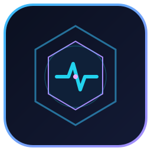
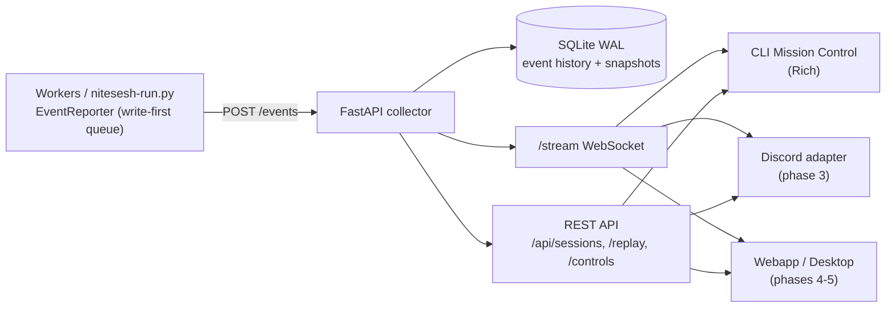

<div align="center">



# HERMES WORKFORGE

### Cross-platform observability & control for autonomous AI work


**One event stream. One source of truth. Every interface.**

🌐 [Live landing page](https://hermes-workforge.pages.dev) · ⭐ [GitHub repo](https://github.com/Chimthuwu/hermes-workforge)

</div>

---

A live mission-control layer for multi-worker AI operations: workers emit structured events,
the collector owns authoritative state, and the CLI / Discord / Web / Desktop adapters all read
the *same* snapshot. Progress comes from completed task weights and verified evidence — never
from elapsed time or a model's own claim that it is "90% done".

Built first as a local Python service because the proving ground is a multi-repo `/sesh` runner on
Windows. Nothing here modifies Hermes core. The monitoring service is an **observer**, never the
owner of agent sessions.

## Architecture



The worker never knows who is watching. If Discord disconnects or the terminal closes, events are
still queued on disk and replayed on reconnect.

## Install

```bash
git clone https://github.com/Chimthuwu/hermes-workforge.git
cd hermes-workforge
python -m pip install -e .          # or: pip install fastapi uvicorn pydantic httpx rich websockets
python -m unittest discover -s tests -v   # 18 tests, all green
```

## Three-terminal quickstart

```bash
# 1 — collector (localhost only by default)
workforge serve                     # http://127.0.0.1:8765

# 2 — fire a realistic 5-project demo run
python examples/demo_session.py

# 3 — watch it live
workforge monitor                   # keys 1-4 switch views, Q quits the view (never the job)
```

One-shot alternatives:

```bash
workforge snapshot --session DEMO-MULTI-001
workforge replay DEMO-MULTI-001 --limit 40
workforge discord --dry-run --batch 1.0   # verify the Discord adapter, no token needed
workforge doctor
```

Set `WORKFORCE_DB` to move the SQLite file (default `~/.workforce/workforce.db`) and
`WORKFORCE_QUEUE` to move the durable spool (default `~/.workforce/queue`).

## Emitting events from a worker

```python
from workforce.events import EventReporter
from workforce.models import Evidence

r = EventReporter(
    endpoint="http://127.0.0.1:8765",
    session_id="MULTI-001", project_id="SydForge", worker_id="worker-01",
)

r.emit("worker_started", "running", task="Audit pedestrian AI")
r.emit("task_plan", "running", metadata={"tasks": [
    {"id": "t1", "name": "Inspect systems", "weight": 1, "status": "completed"},
    {"id": "t2", "name": "Implement AI", "weight": 4, "status": "running"},
    {"id": "t3", "name": "Verify", "weight": 2, "status": "queued"},
]})
r.emit("file_modified", "running", metadata={"files": ["src/world/pedestrians.js"]})
r.emit("test_passed", "running", evidence=Evidence(
    claimed=True, implemented=True, verified=True, tests_passed=18, files_changed=4))
r.emit("commit_created", "running", evidence=Evidence(
    claimed=True, implemented=True, verified=True, committed=True,
    tests_passed=18, files_changed=4, commit="a82c91f"))
r.emit("worker_completed", "completed")
```

Every event is written to a JSONL spool with `fsync` **before** any HTTP call. Delivery retries on
the next `emit()` or an explicit `r.flush()`; the collector dedupes by `event_id`. A dead collector
returns `None` — it never raises into the worker.

### Event shape (v1)

```json
{
  "schema_version": "1.0",
  "event_id": "b7d1...",
  "session_id": "MULTI-001",
  "project_id": "SydForge",
  "worker_id": "worker-01",
  "event": "discovery_completed",
  "status": "running",
  "task": "Audit pedestrian AI",
  "message": "Identified 4 missing systems",
  "timestamp": "2026-11-23T00:28:14Z",
  "metadata": {},
  "evidence": null
}
```

Common event names: `worker_started`, `task_plan`, `task_started`, `task_completed`, `task_failed`,
`tool_started`, `tool_completed`, `file_modified`, `discovery_completed`, `test_passed`,
`test_failed`, `commit_created`, `push_completed`, `worker_heartbeat`, `worker_blocked`,
`worker_completed`, `worker_failed`, `attention_required`.

## REST API

| Method | Path | Purpose |
|---|---|---|
| POST | `/events` | Ingest one event (deduped) |
| GET | `/api/health` | Service health + active subscribers |
| GET | `/api/sessions` | Session list |
| GET | `/api/sessions/{id}` | Authoritative snapshot (projects, workers, attention) |
| GET | `/api/sessions/{id}/events` | Event history, optional `since` / `limit` |
| GET | `/api/sessions/{id}/replay` | Full timeline — session replay |
| POST | `/api/sessions/{id}/plan` | Set a weighted task plan |
| GET / POST | `/api/sessions/{id}/controls` | Pause / resume / cancel **requests** |
| GET | `/api/attention` | Blocked, failed and stalled workers |
| GET / PUT | `/api/sessions/{id}/platform-messages` | Persistent Discord message/thread IDs |
| WS | `/stream?session_id=` | Live events + 100-event history on connect |

Controls are *requests* to the orchestrator, not process-kill switches. Approval boundaries stay
with the runner.

## Discord adapter (Phase 3)

One aggregate consumer for the existing bot channel — never one message per worker:

```bash
export WORKFORCE_DISCORD_TOKEN=...        # set in the bot's environment, never in chat
export WORKFORCE_DISCORD_CHANNEL_ID=...
workforge discord --channel-id 123456789
```

- A single persistent mission-control embed, edited in place; the message ID is stored
  collector-side, so restarts reuse the same message.
- Critical events and approvals push immediately; routine events go to per-project threads.
- Slash commands: `/mission`, `/workers`, `/attention`, `/logs`, `/control`.
  Controls are requests to the orchestrator — no direct process kills.
- Batches edits (default 2s), reconnects with backoff, and flushes the final batch on shutdown.
- Discord outages never affect workers or the collector.

Verify with no credentials and no second bot: `workforge discord --dry-run --batch 1.0`.
Verified against the demo: 48 events → 2 embed edits, 2 attention pushes, 46 thread posts,
one stable dashboard message ID.

## The non-negotiables

1. **Progress = completed task weight / total task weight.** Never elapsed time, never a model's estimate.
2. **Proof of work.** `claimed → implemented → verified → committed → pushed` are distinct states. A green light needs evidence.
3. **Reporting never breaks work.** Write-first spool, retries, dedupe, and swallow all reporter errors.
4. **One source of truth.** Interfaces render snapshots; they do not compute their own progress.
5. **Stalled ≠ dead.** Idle / investigate / stalled are flags for investigation. Never auto-kill a worker mid-tool-call.
6. **Redact at the schema boundary.** Credential-shaped values *and* sensitive key names are scrubbed before storage.
7. **Version the protocol.** `schema_version` ships on every event so the store can evolve.
8. **Observer, not owner.** Native Hermes sessions stay with the gateway; Workforge correlates and displays.

## Roadmap

| Phase | Scope | Status |
|---|---|---|
| 1 | Event schema, durable reporter, collector, SQLite, state recovery | ✅ shipped |
| 2 | CLI Mission Control + session replay + attention panel | ✅ shipped |
| 3 | Discord adapter: persistent embed, threads, slash commands, controls | ✅ shipped |
| 4 | Webapp integration via gateway-proxied WebSocket | ⬜ next |
| 5 | Hermes Desktop mission-control view | ⬜ |
| 6 | Native runtime instrumentation (tools, subagents, approvals) | ⬜ |
| + | Swarm view, dependency graph, resource/cost analytics, wallboard | 💡 ideas |

Detail and acceptance criteria live in [`TODO.md`](TODO.md).

## Layout

```
workforce/
  models.py     versioned event schema, evidence, redaction
  events.py     durable EventReporter (spool → retry → dedupe)
  storage.py    SQLite WAL store, snapshot builder, replay
  health.py     heartbeat + stale-worker classification
  server.py     FastAPI collector, REST + WebSocket
  cli.py        Rich mission control (monitor / snapshot / replay / doctor)
examples/
  demo_session.py   5-project demo with one deliberately blocked worker
workforce/adapters/  Discord adapter (optional discord.py, dry-run verifiable)
tests/              18 unittest tests (no extra test dependency)
assets/             generated mark: SVG + PNG/ICO at 16-512px
site/               static landing page (self-contained, with its own favicon)
scripts/make_icon.py  reproducible icon generator (Pillow)
wrangler.jsonc      Workers static-assets deploy config
```

## Desktop shortcut

A verified **HERMES WORKFORGE - Mission Control** shortcut on the Desktop launches
`python -m workforce monitor` from this folder using the stable system Python 3.11 and the
generated `.ico`. It quits the view with `Q` — it never stops a worker.

No separate Electron wrapper was built on purpose: Workforge's desktop target is the existing
Hermes Desktop app (Phase 5), not a fourth independent interface.

## Deploy

The landing page is on Cloudflare Pages: **https://hermes-workforge.pages.dev**.
Pages uses the default config path, so deploy from the `site/` folder:

```bash
cd site && wrangler pages deploy . --project-name=hermes-workforge --branch=main
```

`wrangler.jsonc` at the repo root is the Workers static-assets config (`wrangler deploy`);
Pages ignores it with a warning because the two config formats are mutually exclusive.

## Security

Binds to `127.0.0.1` by default. Do not expose the development API publicly — put remote access
behind the authenticated Hermes gateway or a trusted VPN. Events are redacted before they reach
disk. Do not put real secrets in `metadata`; the redactor is a backstop, not a licence.

## License

MIT © 2026 Chimthuwu. Built for the Hermes multi-worker `/sesh` workflow. ヽ(>∀<☆)ノ
